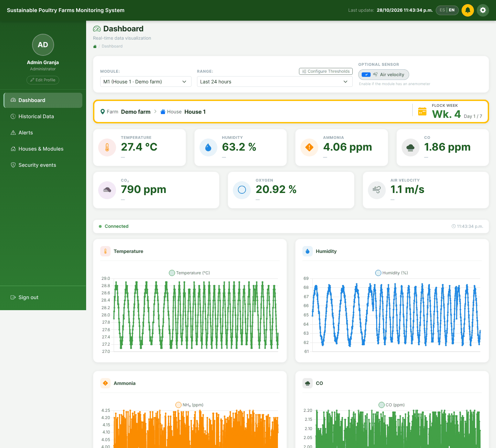
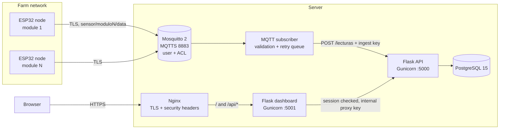
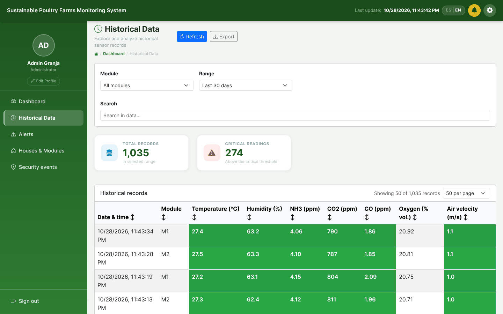
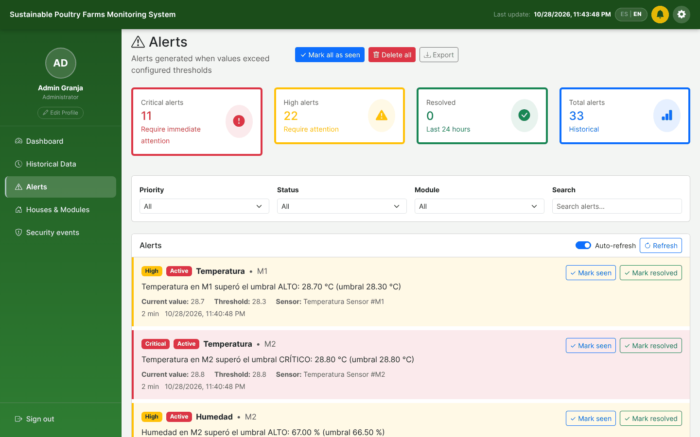
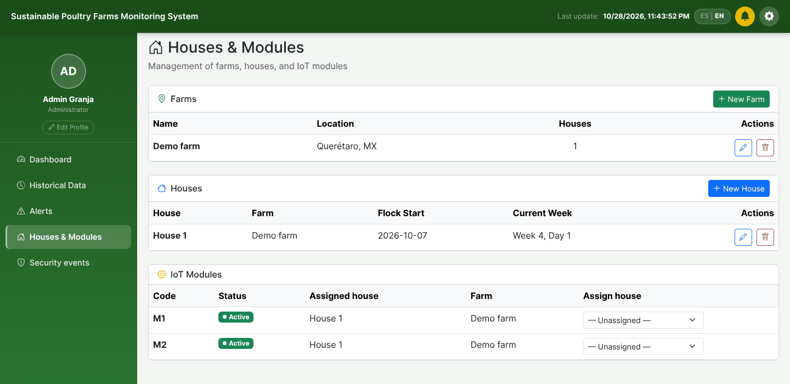
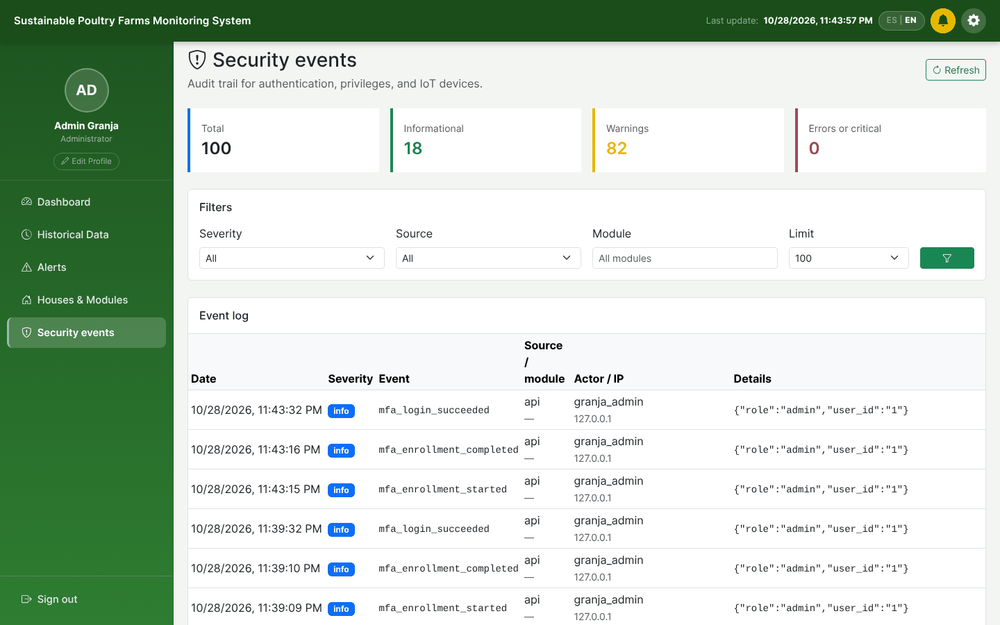
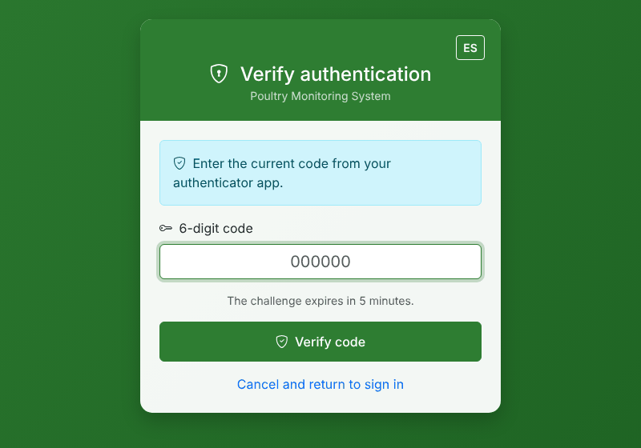
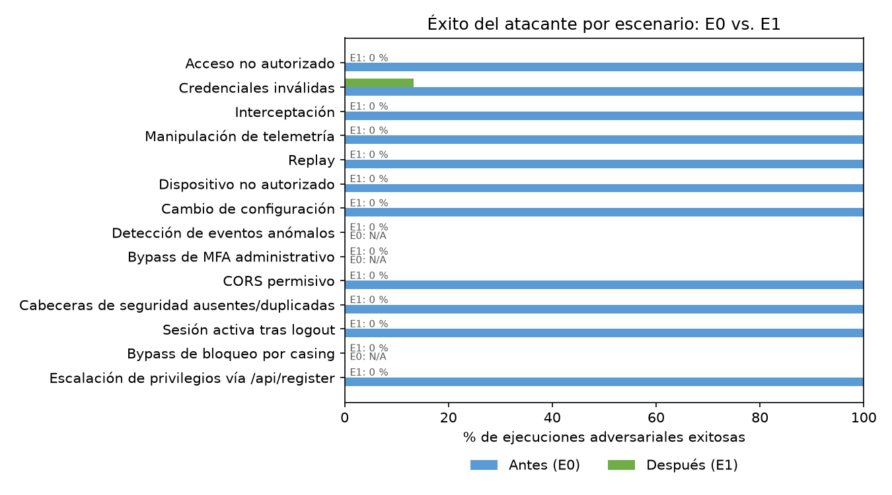

# Poultry IoT System V2

**Secure environmental monitoring for broiler houses.** ESP32 sensor nodes
measure temperature, humidity, CO₂, CO, ammonia, oxygen and air velocity; a
hardened stack validates, stores and displays the readings, raises alerts and
keeps an audit trail. The security controls follow the NIST Cybersecurity
Framework 2.0 and are measured with an included penetration-testing harness.

[](https://github.com/LUISFERNANDOG2/poultry-iot-system-v2/actions/workflows/security-scan.yml)
[](https://github.com/LUISFERNANDOG2/poultry-iot-system-v2/actions/workflows/container-hardening.yml)
[](https://github.com/LUISFERNANDOG2/poultry-iot-system-v2/actions/workflows/dependency-audit.yml)
[](https://github.com/LUISFERNANDOG2/poultry-iot-system-v2/actions/workflows/nginx-security-headers.yml)

[](LICENSE)



<sub>Screenshots show the system running end to end with two simulated nodes
(`scripts/simulate_raspberry_node.py`), not field data.</sub>

## Contents

- [Features](#features)
- [Architecture](#architecture)
- [Screenshots](#screenshots)
- [Security controls](#security-controls)
- [Security evaluation](#security-evaluation)
- [Quick start](#quick-start)
- [Sensor nodes](#sensor-nodes)
- [Telemetry contract](#telemetry-contract)
- [Development and tests](#development-and-tests)
- [Repository layout](#repository-layout)
- [Documentation](#documentation)
- [Citation](#citation)
- [License](#license)

## Features

- **Live monitoring** of seven variables per module, with ▲/▼ trend
  indicators, per-variable charts and an optional air-velocity panel for nodes
  that have an anemometer.
- **History** by module and time range (from the last minute to 90 days, or a custom range),
  with sortable tables, threshold colouring and CSV export.
- **Alerts** when a variable crosses its high or critical threshold, with
  acknowledge/resolve workflow and optional Telegram notification.
- **Farm structure**: farms, houses with flock start date and week of age, and
  IoT modules assigned to each house; node online/offline status and heartbeat.
- **Security events** page with the audit trail of logins, MFA, privileged
  actions and rejected MQTT messages.
- **Bilingual interface** (Spanish and English).
- **Runs offline inside the farm**: no CDN, every front-end library is served
  by the server itself.

## Architecture



Every service port binds to `127.0.0.1` or the Docker network; Nginx is the
only public entry point. In the [farm profile](#farm-profile) the broker's
TLS port is also published on the local network for the nodes.

| Component | Path | Role |
|---|---|---|
| API | `api_avicola/api.py` | Validation, storage, JWT/session auth, RBAC, MFA, lockout, alerts, audit |
| MQTT subscriber | `api_avicola/mqtt_subscriber.py` | Topic and payload validation, retry queue, node status and heartbeat |
| Dashboard | `dashboard_avicola/` | Server-rendered Flask UI and authenticated proxy to the API |
| Broker | `mosquitto/config/` | Password file, per-user ACL, MQTTS |
| Reverse proxy | `deploy/nginx/` | TLS, HSTS, CSP, strips internal proxy headers |
| Node firmware | `Modulos_IoT/` | ESP32 firmware and access-point scripts for the farm network |

## Screenshots

| Historical data | Alerts |
|---|---|
|  |  |
| **Houses and modules** | **Security events** |
|  |  |

<p align="center"><br/><sub>Administrators sign in with a TOTP second factor.</sub></p>

## Security controls

Controls grouped by NIST CSF 2.0 function. The full endpoint inventory, risk
register and residual risks are in
[docs/endpoint-inventory-risk-matrix.md](docs/endpoint-inventory-risk-matrix.md).

| Function | Controls |
|---|---|
| **Identify** | Inventory of HTTP routes, ports and MQTT topics with a risk register (R-01 to R-18) |
| **Protect** | JWT and server-side sessions; RBAC (`admin`, `operador`, `visor`) checked in the dashboard and again in the API; TOTP MFA for administrators with encrypted secrets; persistent account lockout and per-endpoint rate limits; MQTT authentication, per-user ACL and TLS; HTTPS with HSTS, CSP and one set of security headers; schema, range, freshness and replay validation of every reading; no default accounts and refusal to start with placeholder or leaked secrets; non-root, read-only containers; hash-pinned dependencies |
| **Detect** | Security-event log for authentication, MFA, privileged actions and rejected MQTT messages; node heartbeat and last-will status; CI with Bandit, Gitleaks, pip-audit and container and Nginx checks |
| **Respond** | Threshold alerts with acknowledge/resolve workflow and optional Telegram notification; lockout and rate-limit responses recorded as events |
| **Recover** | Daily compressed backups, encrypted off-site copy (3-2-1), scripted restore test and documented RTO/RPO targets |

## Security evaluation

`Pentesting/` contains a harness of 16 attack scenarios (T01-T16) that runs the
same attacks against the baseline (E0, the system before hardening, commit
`15ea85f`) and the hardened version (E1). Each scenario is repeated 30 times.

Local run of 28 October 2026 (E1 behind Nginx with TLS):

| Indicator | E0 baseline | E1 hardened |
|---|---|---|
| Attacker success, mean over the 11 scenarios evaluated in both | 100.0 % | 1.2 % |
| Scenarios where the attacker succeeded at least once | 11 of 11 | 1 of 11 |

The only non-zero E1 result is invalid-credential guessing (T02, 13.3 %): the
first four wrong passwords get a normal 401 before the account locks on the
fifth, as designed. MFA bypass, lockout bypass and anomaly-event detection (T10,
T11, T15) do not exist in E0, so they are reported for E1 only (0 %). Raw JSON,
tables and chart are in
[Pentesting/evidence/2026-10-28-local/](Pentesting/evidence/2026-10-28-local/).



To reproduce against **your own** test deployment, see
[Pentesting/README.md](Pentesting/README.md).

## Quick start

Requirements: Docker Engine with Compose v2.24 or later, and OpenSSL.

1. **Secrets.** Copy the template and replace every value. The API will not
   start with the example values or with a secret known to have leaked.

   ```bash
   cp .env.example .env
   python3 -c 'import secrets; print(secrets.token_hex(32))'    # SECRET_KEY, JWT_SECRET_KEY, INGEST_API_KEY
   python3 -c 'import secrets; print(secrets.token_urlsafe(48))' # SECURITY_EVENTS_API_KEY, DASHBOARD_PROXY_KEY
   python3 -c 'import base64,secrets; print(base64.urlsafe_b64encode(secrets.token_bytes(32)).decode())'  # MFA_ENCRYPTION_KEY
   ```

2. **Broker certificates and MQTT users.** List the names or addresses the
   nodes will use to reach the broker so the certificate matches them.

   ```bash
   MQTT_TLS_IPS=10.42.0.1 scripts/generate_mqtt_tls_certs.sh
   docker run --rm -v "$PWD/mosquitto/config:/mosquitto/config" eclipse-mosquitto:2 \
     mosquitto_passwd -b -c /mosquitto/config/passwd mqtt_sensor_user '<MQTT_PASSWORD>'
   docker run --rm -v "$PWD/mosquitto/config:/mosquitto/config" eclipse-mosquitto:2 \
     mosquitto_passwd -b /mosquitto/config/passwd mqtt_subscriber_user '<MQTT_SUBSCRIBER_PASSWORD>'
   ```

3. **Start the stack and create the accounts.** There are no default accounts
   and no public sign-up. Create the first administrator on the server; it
   enrols TOTP at its first sign-in. Add other users the same way.

   ```bash
   docker compose up -d --build
   docker compose exec api flask --app api_avicola.api:app create-admin --username <admin>
   docker compose exec api flask --app api_avicola.api:app create-user --username <name> --role operador
   ```

   Roles: `admin` (everything, MFA required), `operador` (thresholds, alerts,
   module assignment, security events) and `visor` (read only).

4. **Upgrading an existing database** only: apply the SQL migrations in order.

   ```bash
   for f in scripts/migrations/*.sql; do
     docker compose exec -T db psql -U "$POSTGRES_USER" -d "$POSTGRES_DB" < "$f"
   done
   ```

5. **Publish with Nginx** using `deploy/nginx/poultry-api.conf`
   ([guide](docs/nginx-security-headers.md)). Browsers use `/`; `/backend/` is
   the API for JWT clients such as scripts and the pentest harness.

### Farm profile

When the server runs inside the farm and the nodes publish over the local
network, add the farm override. It publishes only MQTTS (8883) on the LAN.

```bash
docker compose -f docker-compose.yml -f docker-compose.farm.yml up -d
```

`Modulos_IoT/localap/` sets up a dedicated Wi-Fi access point for the nodes.
Restrict port 8883 to that network with the host firewall.

## Sensor nodes

**ESP32 firmware** (`Modulos_IoT/firmware_modulo_iot_json/`). Copy
`config.example.h` to `config.h` (ignored by git), fill in the Wi-Fi network,
broker address, MQTT credentials and the broker CA certificate, and build with
the Arduino ESP32 core and the libraries listed in the sketch header. The node
gets the time over NTP, publishes over TLS and sends `null` for any gas
channel whose calibration constant is still 0, so raw ADC counts never reach
the database as ppm.

**Simulator** for end-to-end tests without hardware:

```bash
MQTT_BROKER=localhost MQTT_USERNAME=mqtt_sensor_user MQTT_PASSWORD='<...>' \
MQTT_TLS_CA_CERT=mosquitto/certs/broker/ca.crt SIMULATOR_MODULE=modulo1 \
python scripts/simulate_raspberry_node.py
```

## Telemetry contract

Topic `sensor/modulo<N>/data` (stored as module `M<N>`), JSON payload:

| Key | Unit | Range | Required |
|---|---|---|---|
| `id_lectura` | text, unique | up to 100 characters | yes |
| `hora` | ISO 8601, UTC | at most 24 h old and 5 min ahead | yes |
| `temp` | °C | -40 to 125 | yes |
| `hum` | % | 0 to 100 | yes |
| `co2` | ppm | 400 to 5000 | yes |
| `co` | ppm | 0 to 500 | no |
| `nh3` | ppm | 0 to 100 | no |
| `o2` | % vol. | 0 to 25 | no |
| `vel` (or `wind`) | m/s | 0 to 30 | no |

Optional keys may be missing or `null`; a value outside its range rejects the
whole reading. Nodes also publish `online`/`offline` (retained, with last will)
to `sensor/modulo<N>/status` and `{"timestamp", "uptime_seconds"}` to
`sensor/modulo<N>/heartbeat`. All timestamps are stored and returned in UTC
(`...Z`); the browser shows local time.

## Development and tests

```bash
python -m pip install -r requirements.txt pytest
python -m pytest -q local_tests
```

The tests run against the real schema on SQLite (`create_all`) without
database mocks. CI runs them inside the hardened API image, together with
Bandit, Gitleaks, pip-audit and the container and Nginx checks.

## Repository layout

```
api_avicola/            API, MQTT subscriber, MFA helpers
dashboard_avicola/      Dashboard (templates, static assets, vendored libraries)
deploy/                 Nginx virtual host, systemd backup units
docs/                   Security inventory, hardening and operations guides
local_tests/            Unit and policy tests
Modulos_IoT/            ESP32 firmware and farm access-point scripts
mosquitto/config/       Broker configuration and ACL
Pentesting/             Attack harness T01-T16 and dated evidence
scripts/                Certificates, migrations, backups, node simulator
```

## Documentation

| Topic | Document |
|---|---|
| Endpoints, ports, MQTT topics and risk register | [endpoint-inventory-risk-matrix.md](docs/endpoint-inventory-risk-matrix.md) |
| Closure of residual risks | [hardening-final-closure.md](docs/hardening-final-closure.md) |
| Container hardening | [container-hardening.md](docs/container-hardening.md) |
| Nginx security headers and HSTS | [nginx-security-headers.md](docs/nginx-security-headers.md) |
| Dependency audit and pinning | [dependency-audit.md](docs/dependency-audit.md), [dependency-pinning.md](docs/dependency-pinning.md) |
| Deployment runbook and evidence | [deployment-security-evidence-guide.md](docs/deployment-security-evidence-guide.md) |
| Backups, off-site copy and restore | [backup-operations.md](docs/backup-operations.md), [restore-test-procedure.md](docs/restore-test-procedure.md), [backup-retention-rto-rpo.md](docs/backup-retention-rto-rpo.md) |

Never commit `.env`, certificates, private keys, MQTT password files,
database dumps or logs; `.gitignore` covers them.

## Citation

If you use this software, please cite it using the metadata in
[CITATION.cff](CITATION.cff) (GitHub's "Cite this repository" button).

## License

MIT License, see [LICENSE](LICENSE).

Developed as part of the AviSmartFarm master's thesis project at the
Instituto Tecnológico de San Juan del Río (Tecnológico Nacional de México).
